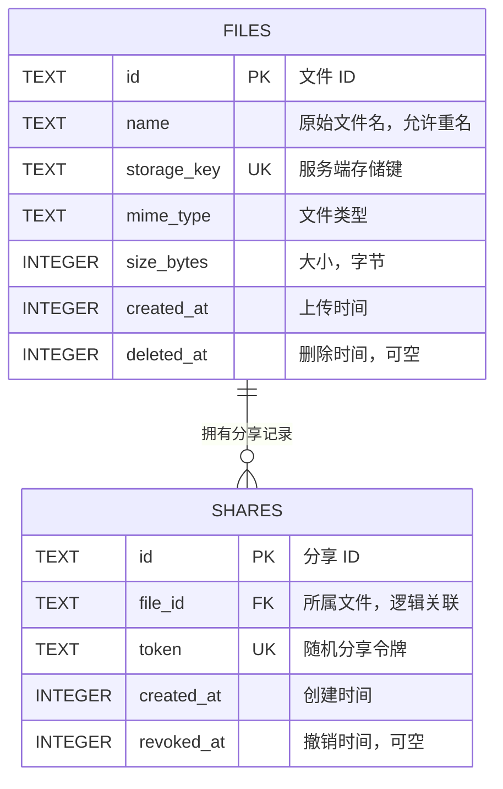

# 数据库设计与 E-R 图

基于 PRD MVP，使用 SQLite，仅保留文件、分享两张业务表。管理账号的密码哈希、CLI 访问令牌的哈希及会话签名密钥通过服务配置提供，不建用户、团队、角色或登录会话表；网页使用有期限的签名 Cookie。接收者匿名访问，不作为实体。

## E-R 图

图中的 FK 为逻辑外键，不创建数据库外键约束。

文件与分享记录为一对多：一个文件可以从未分享，也可以多次分享；任一时刻最多一条未撤销的分享记录。

## 字段与存储约定

### files：文件元数据

| 字段 | 类型 | 约束 / 含义 |
| --- | --- | --- |
| id | TEXT | 主键，服务端生成 UUID |
| name | TEXT | 非空原始文件名，仅用于显示和下载，不作为磁盘路径；允许重名 |
| storage_key | TEXT | 非空且唯一，服务端生成的相对存储键，不包含用户提供的路径 |
| mime_type | TEXT | 非空，由服务端检测；默认 application/octet-stream |
| size_bytes | INTEGER | 非负，上传完成后的实际字节数 |
| created_at | INTEGER | 非空，UTC Unix 毫秒 |
| deleted_at | INTEGER | 可空；非空表示已删除，不再出现在正常列表中 |

文件内容存本地目录，数据库不存二进制内容。上传上限由服务配置控制，不固化到表结构。

### shares：分享记录

| 字段 | 类型 | 约束 / 含义 |
| --- | --- | --- |
| id | TEXT | 主键，服务端生成 UUID |
| file_id | TEXT | 非空逻辑外键，关联 files.id；数据库不创建外键约束 |
| token | TEXT | 非空且唯一，32 字节安全随机数的 Base64URL 无填充编码（43 字符） |
| created_at | INTEGER | 非空，UTC Unix 毫秒 |
| revoked_at | INTEGER | 可空；为空表示未撤销，非空表示永久失效 |

分享 URL 为 `<PUBLIC_BASE_URL>/s/<token>`，不存完整 URL，方便修改域名。为满足重复分享和文件查询时返回原链接，MVP 保存原始分享令牌；该字段视为访问凭证，禁止写入应用日志，数据库和备份限制访问。

不额外存 share_status：文件未删除且存在未撤销分享时为 shared，否则为 unshared。公开访问还必须检查文件未删除。

## 索引与约束

- files.storage_key 唯一：避免存储键冲突。
- files.created_at + id 部分索引：支持未删除文件按时间排序、稳定分页。
- shares.token 唯一：公开链接查找。
- shares.file_id 部分唯一索引（revoked_at IS NULL）：数据库保证一个文件最多一条有效分享。
- shares.file_id + created_at：查询文件的分享历史，供内部操作使用；MVP 不做历史页面。
- 名称包含搜索采用参数化 LIKE，对 `%`、`_` 作字面量转义；MVP 数据量较小，暂不引入全文索引。
- 仅使用逻辑外键，不创建 REFERENCES / FOREIGN KEY 或跨表触发器。关联校验和关联更新由应用服务层在事务中维护。正常删除使用软删除，不物理删除元数据。

完整可执行 DDL 见同目录 schema.sql。

## 业务操作与一致性

### 上传

先写临时文件，校验大小和类型，移动到服务端生成的存储路径，再写入 files。数据库写入失败时清理文件；进程崩溃遗留的无引用文件可在启动时清理。上传成功只产生 files 记录。

### 开启分享

在写事务中确认文件未删除，查询未撤销分享；若存在直接返回原链接，否则生成新 token 并插入。并发由 SQLite 写事务和部分唯一索引兜底；冲突后读取已存在的有效分享。重新分享必须生成新 token，不修改旧记录。

### 撤销分享

将该文件未撤销记录的 revoked_at 写为当前时间；重复撤销按成功处理。旧记录保留，不允许恢复为未撤销状态。

### 删除文件

在事务中设置 files.deleted_at，并由应用服务层同时更新有效分享的 revoked_at。提交后删除磁盘内容，失败时重试清理。这样即使磁盘删除失败，文件也不能再被访问。保留少量元数据用于清理和确保旧链接永久失效，MVP 不提供恢复功能。

### 公开访问

通过 token 联查 shares 和 files，同时要求 revoked_at IS NULL、deleted_at IS NULL。通过校验后由服务端流式返回内容；不暴露本地存储路径。不要缓存分享鉴权结果或提供可绕过服务端的静态文件 URL；分享响应使用 Cache-Control: no-store。撤销不能收回已下载内容或保证中止已开始的传输。

## 范围说明

不为用户、接收者、文件夹、访问日志、权限、版本、Skill 或 Agent 单独建表。网页与 CLI 使用相同数据和规则，无需区分上传来源。
